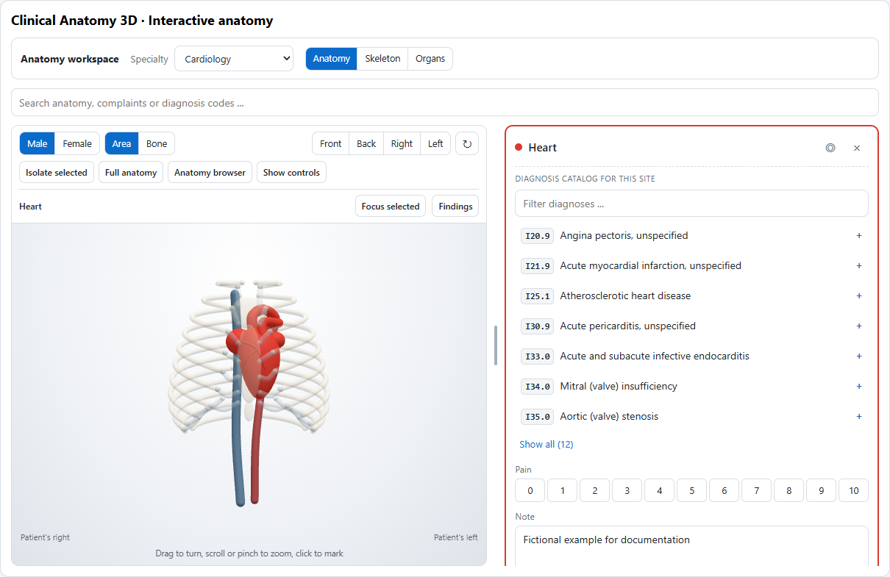
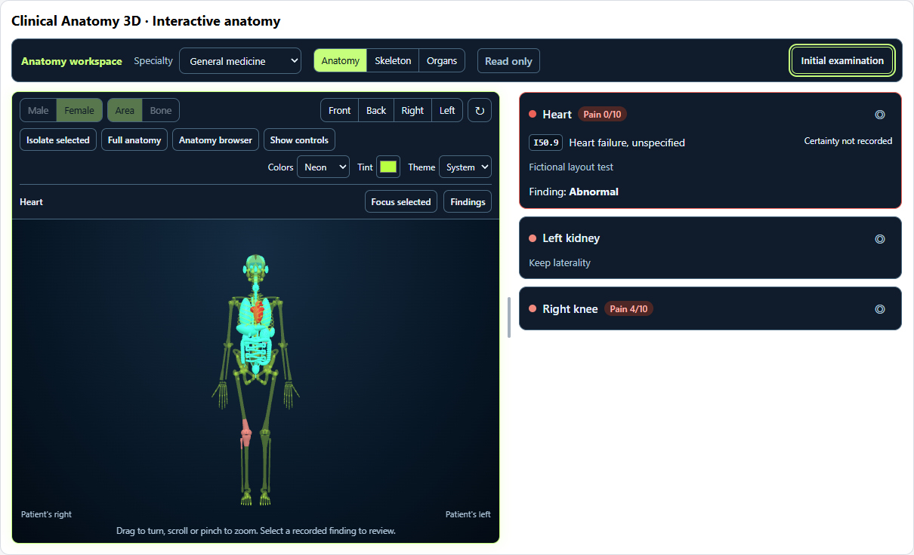

# Clinical Anatomy 3D for Oracle APEX

Oracle APEX item plug-in with schematic 3D anatomy, ten specialty presets, clinical findings, table-backed diagnosis and complaint catalogs, and configurable examination forms.

Requires **Oracle APEX 26.1 or later**. The installer targets APEX 26.1 APIs. WebGL is required for the 3D model. Development checks use Google Chrome and Node.js 22. The repeated layout/appearance suite also supports Playwright Firefox and WebKit.

**Live demo:** [APEX Plugins By Hashaam - Clinical Anatomy 3D](https://oracleapex.com/ords/r/hashaam-admin/apex-plugins-by-hbs/clinical-anatomy-3d) (the sign-in page has a button that fills in the demo account; use fictional data only).

## What it does

- **3D body you can turn and zoom** - drag to rotate, scroll or pinch to zoom, Front / Back / Right / Left views, male and female models
- **Layers** - full anatomy, skeleton only or organs only; pick body areas or individual bones
- **Isolate selected** and **Focus selected** - hide everything else or fly the camera to the structure you picked
- **Anatomy browser** and an **organ list** - pick a structure without hunting for it on the model
- **Complaints and diagnoses** - search "blood in stool" or a code; the matching anatomy lights up and the finding is recorded with its catalog ID
- **Initial examination** - required, optional or off; vitals, physical examination and risks
- **Ten specialty presets** - general medicine, cardiology, orthopedics and more
- **Clinical and Neon colours, light and dark theme** - follows the APEX page or set per item
- **Phone first** - the body comes first on small screens, controls fold away
- **Saves as JSON** into one CLOB column; load it back read-only for review

## Install

1. **Database objects.** As the application's parsing schema run `@db/install.sql`. It creates the package `SKELETON3D_PKG` (the plug-in's render, Ajax and validation callbacks), the shared complaint / diagnosis catalog and the examination tables. Safe to run again. For the 3D body only - no diagnoses, complaints or examination - `@db/skeleton3d_pkg.sql` is enough.
2. **Plug-in.** Shared Components > Plug-ins > Import `plugin/item_type_plugin_com_hashaam_skeleton_3d.sql` (also attached to the [release](https://github.com/HashaamShoukat/apex-plugin-clinical-anatomy-3d/releases)).

Then add a page item of type **Clinical Anatomy 3D** with CLOB session state, pick the specialty and the initial view, and save the item's value into a CLOB column with your page's normal save process. Apply your own server-side validations and patient / encounter authorization to that save.

The internal name is `COM.HASHAAM.SKELETON_3D`; the callbacks are in `SKELETON3D_PKG`. The optional scripts `@db/002_demo_records.sql` (demo record storage) and `@db/003_relational_store.sql` (relational storage example) are not needed for the plug-in. Importing the plug-in with SQLcl instead of Builder needs `apex_application_install` to set the workspace, application and parsing schema first.

## Development

`npm ci` then `npm run build` regenerates the browser bundles and database packages in `dist/`, the APEXlang definition and the importable `plugin/item_type_plugin_com_hashaam_skeleton_3d.sql` (all committed). The SQL entry points in `db/` run the generated packages in `dist/db/`. Source lives in `src/` and `plugin/`; build helpers in `tools/`. `npm run package` also writes `dist/release/` and the versioned ZIP with its SHA-256 file; the JavaScript source map is in its `debug/` folder.

`npm test` runs the browser and contract regression suites, including repeated layout and neon-color transitions. Set QA_BROWSER=firefox or QA_BROWSER=webkit when running node qa/layout-stress.mjs to exercise those engines after installing their Playwright browsers. `npm run check:release` builds twice, checks source immutability and deterministic outputs, verifies installer metadata/assets, and scans the release for internal deployment details.

Set `APEX_APP_DIR` explicitly to synchronize the APEXlang plug-in and browser assets into an existing application source directory. Rebuild that application's supporting objects with its build script to include the database packages and package-body loaders. Installation in APEX is a separate operation.

The public display name is **Clinical Anatomy 3D**. The stable internal name is `COM.HASHAAM.SKELETON_3D`. Existing integrations retain `SKELETON3D_PKG`, the `skeleton3d` JavaScript API and event names so upgrades can reuse current items and Dynamic Actions.

Clinic database objects use `CA3D_`: `CA3D_CLINIC_TERMS`, `CA3D_TERM_AREAS`, `CA3D_EXAM_DEFINITIONS`, `CA3D_CLINIC_CATALOG_V` and `CA3D_CLINIC_API`. The clinic installer upgrades the former `SK3_` objects in place, preserving catalog IDs, anatomy links and examination definitions. It stops if both table prefixes exist so independently populated stores are never combined automatically. Recompile dependent host-application SQL to use the CA3D names; the complete demo installer includes those updates.

## Clinical use and patient access

This software is not a medical device. Anatomy is schematic and incomplete. Diagnosis, complaint and examination content is a starter catalog requiring local clinical review and approval. The female model currently hides male-only anatomy and has no female reproductive anatomy coverage.

The host application must enforce patient/encounter authorization, protect submitted patient identifiers, validate data, and provide appropriate storage and audit trails. Every patient SQL or PL/SQL source must check access using authenticated server context. Page-item values submitted by the browser can be changed by the caller. Check ownership or authorization in the source query, including during AJAX refresh.

The original code is licensed under MIT. ICD-10 terminology is attributed to WHO and subject to its separate terms. Redistribution clearance for the selected labels and application-specific mappings remains unresolved. Complete that review before publishing the bundled starter catalog. See the third-party notice and WHO's published license. [Third-party notices](THIRD_PARTY_NOTICES.md), [WHO ICD-10 license](https://icd.who.int/browse10/Content/statichtml/ICD10Volume2_en_2019.pdf)

## Documentation

- [Installation, mandatory versus sample objects, JSON and custom-table guide](docs/integration-guide.md)
- [Specialty and anatomy configuration](docs/configuration.md)
- [Clinic workflow and form setup](docs/clinic-workflow.md)
- [Patient context and prefill](docs/patient-context.md)
- [Returned JSON contract](docs/payload-contract.md)
- [Diagnosis catalog and sources](docs/diagnosis-catalog.md)
- [Workspace and read-only review](docs/workspace-and-review.md)
- [Relational storage](docs/relational-storage.md)
- [Catalog reporting](docs/catalog-schema.md)

## Current release

- **1.9.0** puts the 3D body first on phones, with controls in a disclosure, and adds verified ZIP packaging. It removes Clinic Mode, Catalogue Scope and external diagnosis SQL configuration. Every item uses the application's shared tables. The pre-production upgrade combines duplicate starters, forms and anatomy links, remaps stored demo references, and removes duplicate IDs entirely.
