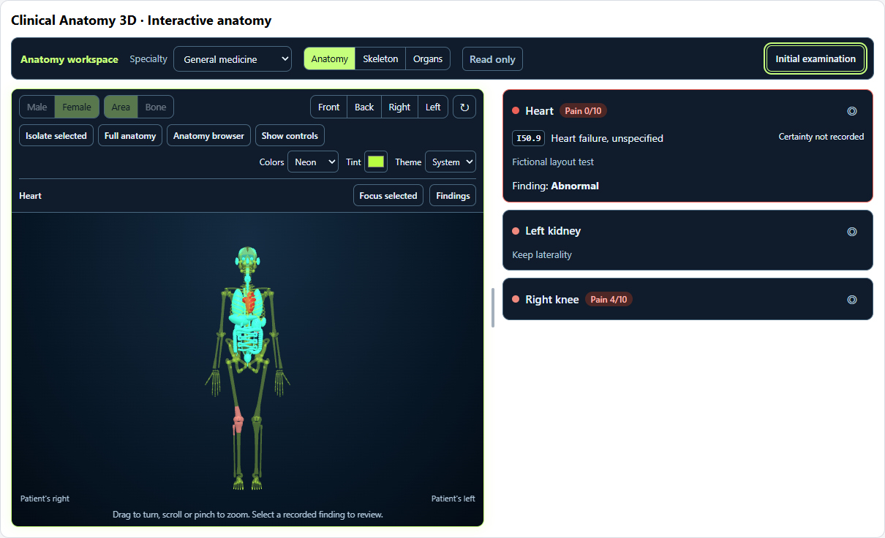

The importable plug-in file is `plugin/item_type_plugin_com_hashaam_skeleton_3d.sql`. Requires Oracle APEX 26.1 or later. Follow the README install steps.

Configure each page item's **Anatomy → Specialty** in APEX Builder. **Initial View** chooses the specialty default, Anatomy, Skeleton or Organs. Under **Options**, enable **Specialty Switch** to let users change presets, or disable it to use the configured specialty throughout that item.

| Specialty value | Visible anatomy |
| --- | --- |
| `ALL` | General medicine, all body areas and organs |
| `ENT` | Head, face, jaw, neck, ears, nose, throat, thyroid and airway |
| `OPHTHALMOLOGY` | Eyes and optic nerves, with skull and orbital context |
| `CARDIOLOGY` | Heart with great vessels, aorta, vena cava and chest |
| `UROLOGY` | Kidneys, adrenals, ureters, bladder, urethra and pelvic context, plus the prostate on the male model |
| `INTERNAL_MEDICINE` | Thoracic and abdominal organs, thyroid and urinary tract |
| `GASTROENTEROLOGY` | Esophagus, liver, gallbladder, stomach, pancreas, spleen, small intestine and colon |
| `NEUROLOGY` | Brain, head, neck and vertebral column |
| `PULMONOLOGY` | Lungs, trachea, bronchi and chest |
| `ORTHOPEDICS` | Skeleton and musculoskeletal body areas |

The preset controls visible meshes, organ buttons, searchable anatomy, common complaints and diagnosis search areas. Left/right selection applies to eyes, ears, lungs, kidneys, adrenal glands and ureters. Recorded sites remain in the value when a view changes. Focusing a site outside the configured preset reports that restriction and retains the preset. Full anatomy and Reveal restore visibility within the current specialty.

Anatomy shows colored organs with a translucent skeleton. Skeleton shows bones. Organs shows soft tissue. Bone selection automatically opens the skeleton view. The specialty default opens Organs for Gastroenterology and Skeleton for Orthopedics. Other presets open Anatomy.

The standalone demo accepts `?specialty=ENT`, `?specialty=CARDIOLOGY`, `?specialty=UROLOGY`, `?specialty=OPHTHALMOLOGY`, `?layer=ORGANS`, `?sex=F` and `?specialtySwitch=0`. Options can be combined with `&`.

For JavaScript initialization, the same settings are available directly.

```js
skeleton3d.init("P10_BODY_MAP", {
    specialty: "UROLOGY",
    specialtySwitch: false,
    layer: "ANATOMY"
});
```

For an existing item, use its API.

```js
const anatomy = skeleton3d.get("P10_BODY_MAP");
anatomy.setSpecialty("CARDIOLOGY");
anatomy.setLayer("ORGANS");
anatomy.select("HEART");
anatomy.focus("HEART");
```

Organ selections use the existing version 1 JSON format. Existing skeleton values continue to load.

```json
{"v":1,"sex":"F","sites":[{"area":"KIDNEY","side":"L","label":"Left kidney","pain":4,"diagnoses":[]}]}
```

Enable **Diagnosis Suggestions** to use the application's shared diagnosis table. Import the hospital's approved labels, codes and anatomy mappings into CA3D_CLINIC_TERMS and CA3D_TERM_AREAS. The same base holds starter and locally added entries. See the integration and catalogue guides.

```sql
select code, title, body_areas, coding_system
from clinic_diagnoses
where active = 'Y'
```

The new Builder settings use attributes 11 and 12. Rebuild with `npm run build` to update the JavaScript, CSS, generated package and APEXlang definitions. An installation requires the updated package, plugin attributes and generated static files together.

Run `npm test` from the plugin folder for the original interaction checks and the specialty/organ checks. The browser scripts use the installed Google Chrome at `C:/Program Files/Google/Chrome/Application/chrome.exe`. Install development dependencies with `npm install` first.

The surfaces are simplified procedural models. Placement and system grouping were checked against NIH anatomy references for the heart, respiratory system, digestive system and urinary tract. [Heart anatomy](https://www.nhlbi.nih.gov/health/heart/anatomy), [respiratory anatomy](https://www.nhlbi.nih.gov/health/lungs/respiratory-system), [digestive anatomy](https://www.niddk.nih.gov/health-information/digestive-diseases/digestive-system-how-it-works), [urinary anatomy](https://www.niddk.nih.gov/health-information/urologic-diseases/urinary-tract-how-it-works).

Optional custom clinic lists, general examination, and anatomy tools are documented in [Clinic workflow](clinic-workflow.md). Attributes 13 through 17 keep the existing defaults when unset. Use CLOB session state for larger clinical payloads.

Specialty Page Item (attribute 20) can supply the initial preset and drive client changes. Workspace layout, modal examinations and read-only JSON review are described in [Workspace and review](workspace-and-review.md).

## Model sex, specialty and appearance

APEX items use their configured patient sex as the server authority and do not expose a model-sex switch. A missing or unrecognized Sex Page Item value becomes U (unconfirmed), not male. Side-specific JavaScript selections require exactly L or R: select('KNEE') returns null without recording a finding. Existing unspecified-side area findings can still be reviewed.

A configured specialty constrains saved anatomical areas on the server. Use ALL for records that intentionally span specialties; fixed specialties do not expose the specialty switch.

Installed items follow the APEX page theme by default. Viewer Theme can select APEX page, System, Light or Dark; System follows the operating system. Appearance choices are remembered per application/item in this browser. The palette covers dialogs, warnings, labels, measurement cards and the viewer.

## Neon colors

Use the viewer's Colors menu to switch between Clinical and Neon. Neon adds emissive colors to the anatomy and a dark viewer palette. Tint changes the neon color; normal/abnormal finding colors remain distinct. Theme selects System, Light or Dark for Clinical mode. Appearance changes are available during read-only review and do not modify the assessment JSON.

To initialize neon mode, set colorMode to NEON and neonColor to a six-digit hex color in the item's Initialization JavaScript Function. For example:

```js
function (options) {
    options.colorMode = 'NEON';
    options.neonColor = '#36f5ff';
    return options;
}
```

The JavaScript API exposes setColorMode('CLINICAL' | 'NEON'), setNeonColor('#36f5ff') and setTheme('apex' | 'auto' | 'light' | 'dark'). Invalid values are rejected before changing the current appearance. These settings control display only.



## 1.8 configuration changes

All installed diagnoses and complaints use the shared tables. Clinic Mode, Catalogue Scope and external diagnosis SQL settings were removed in 1.9. Diagnosis Suggestions can be enabled or hidden. Patient Items to Submit remains a multiple-item picker. See [the integration guide](integration-guide.md).

The Height attribute sets the desktop viewer and findings pane height. Page position and scrolling do not shrink or grow it. Small-screen CSS adapts the model height for phones.
